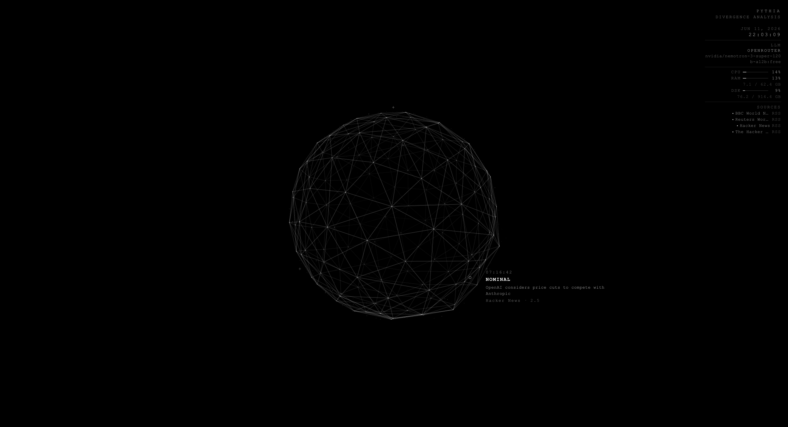

# PYTHIA

> Divergence monitoring ambient display powered by an LLM.
> Inspired by the Rehoboam system from Westworld.



PYTHIA is an autonomous divergence monitoring system. It continuously ingests events from configurable sources (RSS feeds, Uptime Kuma, webhooks), evaluates their criticality using an LLM, and renders the result as a fullscreen ambient visual interface.

It is designed to run silently on a dedicated screen — no interaction, no authentication.

## Views

| Path | Description |
|---|---|
| `/display` | Fullscreen ambient display — meant for a dedicated screen |
| `/feed` | Chronological log of all evaluated events |

The display renders a procedural geodesic sphere (Canvas 2D) that deforms when a divergence is detected, plus a HUD with live system metrics (CPU/RAM/disk, GPU and temperatures on Linux/Jetson, source health, LLM provider).

## Architecture

```
External Sources
      │
      ▼
Ingestion Layer (FastAPI)
├── RSS poller (+ headline dedupe)
├── Uptime Kuma poller
└── Webhook receiver
      │
      ▼
Evaluator (OpenAI-compatible API, streaming)
→ Returns structured JSON: { criticality, category, title, summary, location, source, timestamp }
      │
      ▼
Event Queue (last 100 events, kept in memory and mirrored to a small JSON file)
      │
      ▼
WebSocket broadcast
      │
   ┌──┴──┐
   ▼     ▼
/display  /feed
```

## Requirements

- [Docker](https://docs.docker.com/get-docker/) + Docker Compose
- An API key for an OpenAI-compatible LLM endpoint ([OpenRouter](https://openrouter.ai) recommended)
- A GitHub Actions self-hosted runner on the target machine (for CI/CD)

## Configuration

### Environment variables

Variables are stored in GitHub Settings → Environments → `production` and injected automatically at deploy time. No `.env` file needs to be managed manually.

| Variable | Description | Default |
|---|---|---|
| `LLM_URL` | LLM endpoint (any OpenAI-compatible API) | `https://openrouter.ai/api/v1` |
| `LLM_MODEL` | Model identifier | `nvidia/nemotron-3-super-120b-a12b:free` |
| `LLM_API_KEY` | API key for the LLM endpoint | *(secret)* |
| `PYTHIA_LANGUAGE` | UI and prompt language (`en` or `fr`) | `en` |
| `CRITICALITY_THRESHOLD` | Discard events below this score (they appear nowhere) | `1` |
| `DISPLAY_THRESHOLD` | Events below this score appear in `/feed` only, never on `/display` | `4` |
| `DISPLAY_QUEUE_MAX` | Max events waiting to be shown on `/display` | `10` |
| `DISPLAY_MAX_AGE_S` | A waiting event older than this many seconds is dropped | `600` |
| `LLM_CONCURRENCY` | Max simultaneous LLM requests | `2` |
| `PYTHIA_PORT` | Exposed port (UI, API and webhooks) | `8081` |
| `SOURCES_FILE` | Path to sources config (inside container) | `sources.yaml` |

PYTHIA runs as a single container. Event history and the state of each source (already-seen RSS items, Uptime Kuma statuses) are stored in the `pythia-data` volume, so a restart or an update neither loses the history nor re-evaluates old news. Language and thresholds are read at runtime: change them in the environment and restart, no rebuild needed.

### Sources

Edit `sources.yaml` to configure ingestion sources:

```yaml
sources:
  - type: rss
    name: BBC World News
    url: https://feeds.bbci.co.uk/news/world/rss.xml
    interval: 300  # seconds

  - type: uptime_kuma
    name: Homelab Monitor
    url: http://uptime-kuma:3001
    slug: default
    interval: 60

  - type: webhook
    name: Custom Alerts
    path: /webhook/alerts  # POST endpoint exposed by PYTHIA
```

## API

| Endpoint | Description |
|---|---|
| `GET /health` | Health, active WebSocket connection count, LLM endpoint status |
| `GET /api/events` | Last 100 evaluated events |
| `GET /api/system` | Hardware metrics, source health, LLM provider/model/status |
| `WS /ws` | Event stream — one `history` frame on connect, then live `event` frames |
| `POST /webhook/<path>` | One endpoint per `webhook` source in `sources.yaml` (JSON object, max 64 KB). Answers `202`, the event is evaluated in the background |

## Deployment

Deployment is fully automated via the GitHub Actions CI/CD pipeline on push to `main`.

The self-hosted runner lints and tests the backend and the frontend (and builds the frontend), then:

1. Generates `.env` from the `production` GitHub Environment
2. Runs `docker compose up --build -d`
3. Waits for the health check
4. Runs smoke tests against `/health`, `/api/events`, `/api/system`, `/display` and the WebSocket

To trigger a deploy: push to `main`.

## Local development

```bash
# Backend (port 8000)
cd backend && pip install -r requirements-dev.txt
uvicorn main:app --reload   # also serves ../frontend/dist if it has been built

# Frontend (Vite dev server, proxies /api and /ws to localhost:8000)
cd frontend && npm install
npm run dev
```

Tests:

```bash
cd backend && ruff check . && python -m pytest tests/ -v
cd frontend && npm run lint && npm test -- --run
```

`scripts/check-env.sh` validates a `.env` file against `.env.example`.

## Adding a source

1. Create `backend/sources/my_source.py` extending `BaseSource`
2. Implement `fetch()` returning `List[RawEvent]`
3. Register the type in `SOURCE_REGISTRY` in `backend/sources/__init__.py`
4. Add an entry in `sources.yaml`

Raise on failure instead of returning `[]` (the scheduler then flags the source unhealthy and backs off). To remember something across restarts, override `export_state()` / `load_state()`.

## Criticality scale

The category is always derived from the score, so fractional scores (e.g. 5.5) are valid.

| Range | Category |
|---|---|
| 1.0–3.9 | `NOMINAL` |
| 4.0–5.9 | `ELEVATED SCRUTINY` |
| 6.0–7.9 | `DIVERGENCE` |
| 8.0–9.9 | `INTERVENTION IN PROGRESS` |
| 10.0 | `CRITICAL DIVERGENCE` |
